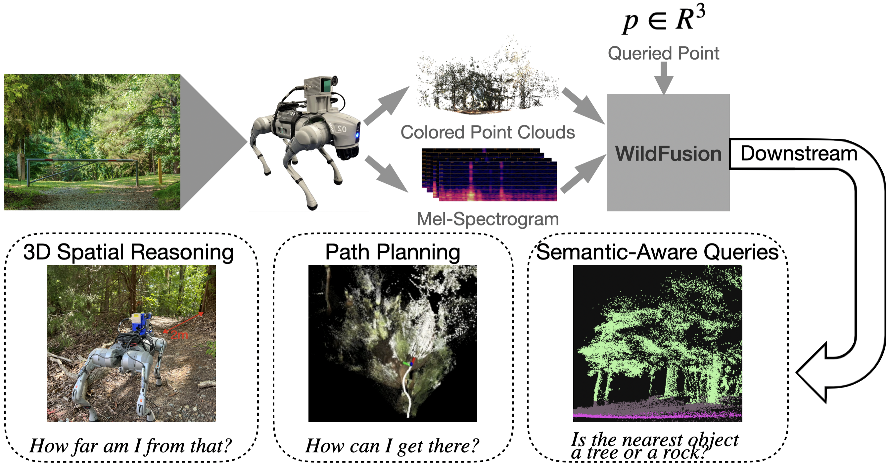

# WildFusion: Multimodal Implicit 3D Reconstructions in the Wild
[Yanbaihui Liu](https://yanbhliu.github.io/), [Boyuan Chen](http://boyuanchen.com/)
<br>
Duke University
<br>

[website](http://generalroboticslab.com/WildFusion) | [paper](https://arxiv.org/abs/2409.19904) | [video](https://www.youtube.com/watch?v=yA_GgW_QJe8)

## Overview
We propose WildFusion, a novel approach for 3D scene reconstruction in unstructured, in-the-wild environments using multimodal implicit neural representations. WildFusion integrates signals from LiDAR, RGB camera, contact microphones, tactile sensors, and IMU. This multimodal fusion generates comprehensive, continuous environmental representations, including pixel-level geometry, color, semantics, and traversability. Through real-world experiments on legged robot navigation in challenging forest environments, WildFusion demonstrates improved route selection by accurately predicting traversability. Our results highlight its potential to advance robotic navigation and 3D mapping in complex outdoor terrains.

<p align="center">
     
</p>

## Prerequisites

1. Clone the repository:

    ```bash
    git clone https://github.com/generalroboticslab/WildFusion.git
    ```

2. Create and activate a new virtual environment:

    ```bash
    virtualenv new_env_name
    source new_env_name/bin/activate
    ```

3. Install the required dependencies:

    ```bash
    pip install -r requirements.txt
    ```

## Training

Run the following command to train the model. The `--scratch` flag will force training from scratch, while `--skip_plot` will skip saving training loss plots.

```bash
python main.py --scratch --skip_plot
```


## Evaluation

To evaluate the trained models and visualize the results, run:

```bash
python evaluation/test.py --test_file /path/to/data
```

To visualize the ground truth in `.pcd` format, use:

```bash
python evaluation/gt_vis_pcd.py --data_path /path/to/data
```

## Dataset
Download our [dataset](https://duke.box.com/s/vlkj5ejzzit0ul738kfs3j105kh28jy5) and unzip

## Hardwares
The list of our hardware set and CAD model are under [hardwares](https://github.com/generalroboticslab/WildFusion/tree/main/hardwares) subdirectory.

## Citation

If you think this paper is helpful, please consider cite our work

```plaintext
@inproceedings{liu2025wildfusion,
  title={WildFusion: Multimodal Implicit 3D Reconstructions in the Wild},
  author={Liu, Yanbaihui and Chen, Boyuan},
  booktitle={2025 IEEE International Conference on Robotics and Automation (ICRA)},
  pages={8603--8603},
  year={2025},
  organization={IEEE}
}
```

## Acknowledgement
[go2_ros2_sdk](https://github.com/abizovnuralem/go2_ros2_sdk)
